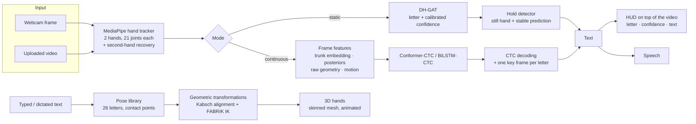
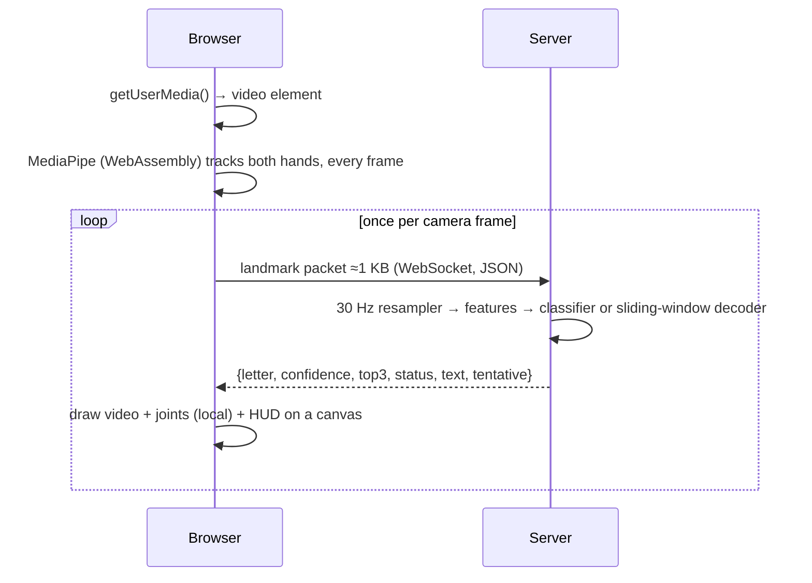

# System overview

The system has two halves that share the same hand-landmark representation: a **recognition** half (sign → text) and a **synthesis** half (text → sign).

## Design principles

1. **Landmarks, not pixels.** Everything downstream of MediaPipe works on 21 joints per hand. This makes the models tiny (0.5 – 2.6 M parameters), CPU-friendly and independent of background, clothing and lighting.
2. **Both hands in one frame.** Most ISL letters are *defined by contact* between the hands. Normalising each hand separately discards that information, so the model works in a shared frame with explicit inter-hand features.
3. **Deployment-faithful evaluation.** Three tests — in-domain, cross-dataset and real-video frames — are reported together (see [Benchmark](../evaluation/benchmark)).
4. **One code path.** Training, offline video analysis and the live webcam all use the same feature code (`src/pipeline/features.py`), so that a figure measured offline also applies to live use.
5. **Everything local.** No cloud calls; the browser talks only to the local Python server.

## Runtime components

| Component | File | Role |
|---|---|---|
| Hand tracker | `src/pipeline/hands.py`, `app/static/js/tracker.js` | MediaPipe (Python on the server, WebAssembly in the browser), hands ordered by wrist-x |
| Static classifier | `src/pipeline/classifier.py` | DH-GAT + temperature calibration |
| Hold detector | `src/pipeline/hold.py` | motion + stability → typed letters (time-based, any frame rate) |
| Continuous recogniser | `src/pipeline/continuous.py`, `streaming.py` | CTC model; offline key frames; live 30 Hz resampling and stable-prefix commit |
| Video analysis | `src/pipeline/video.py` | upload jobs, annotated video |
| HUD | `src/pipeline/overlay.py`, `app/static/js/hud.js` | the same HUD in OpenCV and in the browser |
| Pose library | `src/avatar/build_poses.py` | builds `poses.json` from data |
| Contact geometry | `src/avatar/touch.py` | alignment + IK |
| 3D hands | `app/static/js/avatar.js`, `signer/` | Three.js scene, skinned hands, sleeves |
| Web server | `app/server.py` | Starlette: pages, WebSocket, upload API |

## Data flow in the live tab

Tracking in the browser means no picture ever leaves the page, no JPEG is encoded, and the server only runs the models. At most four packets are in flight, so latency stays bounded. If the browser tracker cannot start, the page falls back to server-side tracking: JPEG frames are sent one at a time and tracked on the server (about 10 fps). See [Live streaming](../continuous-recognition/live-streaming).
