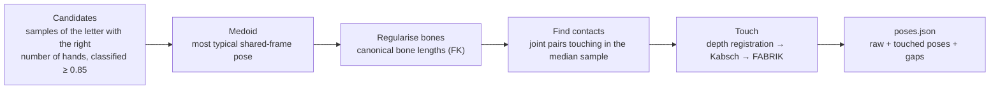

# Pose library

Most letters are **derived from the real data**, so the 3D hands sign what the recogniser was trained to recognise. The letters in which the hands overlap strongly (G, H, J, M, P, Q, R, S) are the exception: the detector is unreliable there, so they are [authored](#authored-letters) from a description of the sign.

```bash
python -m src.avatar.build_poses      # → app/static/data/poses.json  and  results/avatar_contacts.csv
```

## Steps for each letter



1. **Candidates.** Up to 500 samples from Static Dataset A (and the aligned real frames) whose letter the DH-GAT recognises with confidence > 0.85 and whose number of detected hands matches the letter's hand mode. Static_ISL images come from the [second-hand-recovery](../data/landmark-extraction#second-hand-recovery) cache so two-handed letters such as J and R have enough candidates.
2. **Reference = medoid.** The candidate with the smallest summed distance to all others, in the shared frame — a *real* hand pose, not an average that would collapse into a blob.
3. **Bone regularisation.** MediaPipe's joint positions jitter, so fingers look rubbery. Each finger is rebuilt by forward kinematics with the **median bone lengths** (per hand, scaled by its own size), keeping the measured bone directions.
4. **Contacts.** For two-handed letters, the in-plane distance between every pair of joints (one per hand) is computed across all candidates; pairs whose **median skin gap** is below 0.30 hand sizes are contacts (at most 4, distinct joints). Only the image-plane distance is used, because MediaPipe's *z* is relative to each hand's own wrist and the depth offset between hands is unobservable.
5. **Touch** — see [Geometric transformations](geometric-transformations).

## Authored letters

Landmarks detected in photographs are unreliable where the hands overlap, and that is exactly where most ISL letters are formed: fingers collapse, a hand is missing, or the left and right hand are confused. For the letters G, H, J, M, P, Q, R and S the pose is therefore written down instead of measured:

```bash
python -m src.avatar.build_spec_poses --letters GHJMPQRS      # → app/static/data/poses.json ("source": "spec")
```

- `src/avatar/handmodel.py` is a small articulated hand: finger curl angles, spread, a thumb defined by segment directions or by a target for its tip (FABRIK), the palm direction and the finger direction. It returns the same 21 landmarks as the detector, so the renderer, the contact markers and the pose file are unchanged. Handedness follows from the geometry (right hand +1, left hand −1) and is asserted for every pose.
- `src/avatar/spec_letters.py` describes each letter: the base hand is the signer's left hand, the active hand the right hand; for every letter it states the hand shapes, where each palm faces and which joint touches which. Contacts are solved exactly (translation by skin radii, FABRIK for a second contact), so the markers sit on real contact points.
- **Strokes.** H and J are movements (the flat right hand wipes along the left palm; the right index traces a J on the left palm). Their entries carry `keys`, the poses the hands pass through, and the renderer plays them during the hold.

## Hand modes

| One-handed (6) | Two-handed (20) |
|---|---|
| C, I, L, O, U, V | A, B, D, E, F, G, H, J, K, M, N, P, Q, R, S, T, W, X, Y, Z |

One-handed letters are drawn with a single, centred hand; the other hand waits below the frame.

## Output format (`poses.json`)

```json
{
  "meta":    {"unit": "hand size", "radius": [21 joint radii], "parent": [...], "bone_lengths": [...]},
  "letters": {
    "A": {"hands": 2,
          "raw":     [[21×3], [21×3]],     // regularised, before contact alignment
          "touched": [[21×3], [21×3]],     // after alignment
          "contacts": [{"a": 8, "b": 8, "target": 0.16, "gap_raw": 0.70, "gap_touched": 0.001}],
          "chir": [1, -1],                 // handedness each hand's landmarks show (+1 right-type, -1 left-type)
          "n_candidates": 500},
    ...
    "_rest": {...}                          // relaxed pose used between words
  }
}
```

Coordinates are in Three.js convention (x right, **y up**, z toward the viewer) and in **hand-size units** (1 ≈ 9.5 cm).
