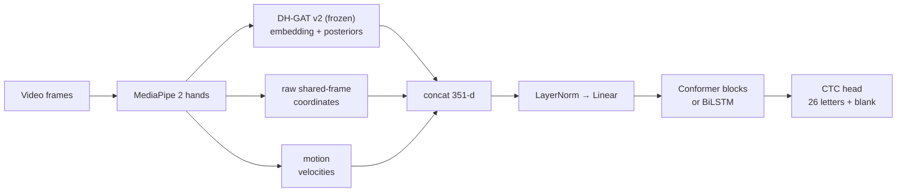

# Continuous recognition: features and models

Continuous fingerspelling is spelling a whole name without stopping at each letter — the hands flow from shape to shape and letters are co-articulated. We treat it as **sequence labelling with CTC** (Connectionist Temporal Classification): the model emits, for every video frame, a probability over 26 letters plus a *blank*, and the loss sums over every frame-to-letter alignment, so no frame-level labels are needed.

## Per-frame features (351 numbers)

`src/pipeline/features.py` — the same code is used for training, offline video analysis and the live webcam.

| Block | Dim | What |
|---|---:|---|
| **trunk** | 192 | pooled embedding of the frozen DH-GAT v2 — a learned hand-shape descriptor |
| **probs** | 26 | the DH-GAT's calibrated static class posteriors ("what letter does this frame look like") |
| **raw** | 126 | shared-frame joint coordinates of both hands |
| **motion** | 7 | wrist velocity of both hands (x, y), mean landmark speed, two presence flags |

Frames with no hand have zeros for trunk/probs/raw and presence flags 0.

## Two encoders, one head

`src/models/cont_v2.py`

| | BiLSTM-CTC | Conformer-CTC |
|---|---|---|
| Input stack | LayerNorm → Linear(351→144) → LayerNorm → GELU → Dropout | same |
| Encoder | 2-layer bidirectional LSTM, hidden 192 | **4 Conformer blocks**, d = 144, 4 heads, convolution kernel **15** |
| Auxiliary loss | – | **intermediate CTC** after block 2 (weight 0.3) |
| Output | Linear → 27 | Linear → 27 |
| Parameters | 1,469,049 | 2,569,140 |

A *Conformer block* is feed-forward ½ → multi-head self-attention → convolution module → feed-forward ½ → LayerNorm (re-used from the v1 code). The convolution captures the local shape of a letter (≈ 0.3 – 0.8 s = 10 – 25 frames); attention captures longer dependencies. The kernel was reduced from 31 to 15 because the dataset is small and 31 frames (≈ 1 s) spans two or three letters.

## What changed relative to the first generation

| | v1 | v2 |
|---|---|---|
| Input | 63 numbers (one hand, wrist-normalised) | 351 numbers (both hands + pretrained embedding + motion) |
| Conformer kernel | 31 | 15 |
| Loss | CTC | CTC + intermediate CTC |
| Augmentation | none | time-stretch, masks, feature dropout, noise |
| Conformer result | 19.26 % test CER (worse than the BiLSTM) | see [Benchmark](../evaluation/benchmark) |

The v1 Conformer under-performed the BiLSTM (14.75 %), which is typical of Conformers on ≈ 70 minutes of data. Pre-trained features, augmentation and a smaller convolution kernel fix that.

## Honest note on stacking

The DH-GAT trunk was trained (among other things) on aligned letters from the **training** videos. Its features on training videos are therefore a little "cleaner" than on validation/test videos, a mild optimism that the sequence model could learn to trust. Mitigations in training: the whole trunk block is **zeroed on 25 % of sequences**, feature dropout and noise. The ablation `--parts raw` (no trunk/probs at all) quantifies how much the pre-trained features really contribute: see [Benchmark](../evaluation/benchmark).
