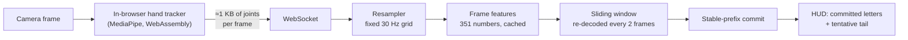

# Live streaming

Reading a recorded video is simpler because the whole clip is available. Reading a webcam is harder: letters arrive one frame at a time, the camera may run at 15, 30 or 60 frames per second, and the answer on screen should be right *and* quick, even when the signer changes letters fast. This page describes how the live recogniser (`src/pipeline/streaming.py`) does it.

## 1 · Track in the browser

The hand tracker (`app/static/js/tracker.js`, the same `hand_landmarker.task` as the server) runs on every camera frame inside the page. Only the joint positions travel to the server, so there is no JPEG encoding, no upload and no detection on the server's critical path. With the browser's GPU delegate, tracking is meant to keep up with the camera's frame rate, where the server-side tracker managed roughly 10 fps. (Measured: the server answers each landmark packet in about 5 ms, so it is not the bottleneck. Tracking speed depends on the machine: a GPU-less headless test browser managed only a few frames per second, and in-browser tracking has not yet been benchmarked on a typical laptop.) The skeleton on screen is drawn from the *local* result, so it never lags behind the picture. If the browser tracker cannot start, the page falls back to server-side tracking.

*Parity check.* The browser tracker was compared with the server tracker the models were trained on by replaying six held-out test videos frame by frame (`tests/browser_parity.mjs`, `src/evaluation/browser_parity.py`). Recognition from the browser's landmarks gave **the same names as the server pipeline on all six videos (0.0 % character error in both)** and hand presence agreed on every frame. In tracking mode (the fast mode used live) the joint positions differ from the server's by a median of 0.11 hand sizes; in full-detection mode, which is what training used, by 0.02 — the models read both identically.

## 2 · Resample to 30 Hz

The models were trained on 30 fps video. `Resampler` linearly interpolates the incoming landmark samples onto a fixed 1/30 s grid (short dropouts are bridged; when the set of visible hands changes, the nearest sample is used), so the model sees the rate it was trained on whatever the camera does. Slower cameras stop being a problem: at 10 fps the live decoder's error is 5.7%, where decoding the raw frames directly would give 13%.

## 3 · Sliding window with a stable-prefix commit

Every second frame, the Conformer re-decodes a window of the most recent frames. A letter is only **committed** when its CTC run has ended and its peak is at least 12 frames (0.4 s) old; younger letters are shown as a greyed **tentative tail** that may still change. After each decode the window slides past the committed letters (keeping 2 s of left context), so the cost stays bounded however long someone spells. Hands out of view for 1 s end the word.

This gives a stable screen — committed letters never change — and a bounded delay: the median letter appears **0.40 s** after it was signed (90th percentile 0.43 s).

## 4 · Training for it

A model that only ever saw whole words can stumble on the partial windows and faster signing of live use. The streaming recipe (`train_cont_v2.py --stream-aug`) adds:

| Augmentation | Why |
|---|---|
| **sub-word crops** cut at letter boundaries (found with CTC forced alignment of the training data) | a live window starts and ends mid-word |
| **speed 0.55–1.3×** of the original duration, with the velocity features rescaled to match | signing up to about 1.8× faster |
| **word joins** — two crops concatenated | continuous spelling of longer names |

## Results

See [Benchmark](../evaluation/benchmark#live-decoding) for the full table. In short, replaying held-out videos through the live decoder: error at normal speed fell from 4.56% to 3.77%, at **double speed from 11.63% to 5.77%**, and at a 10 fps camera from 6.38% to 5.68%, with the delay unchanged.

## Limits

- Repeated letters rely on the model seeing a clear boundary; two identical letters with almost no motion between them can merge.
- There is no space symbol; words are separated by the pause.
- The 0.4 s delay is the price of not showing wrong letters; it can be shortened (`commit_lag`) at the cost of more late corrections.
