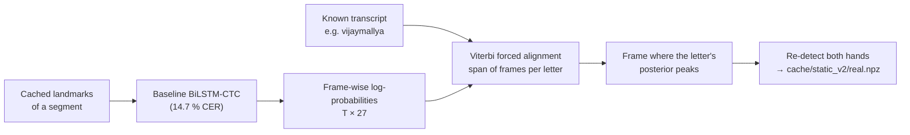

# Aligned real frames: a real-world test set

## Why alignment is needed

Static letter frames can be taken from the continuous videos, but the frame of each letter has to be located. Dividing the duration of a segment evenly among its letters is not adequate: letters are not signed for equal durations, so many frames would carry the wrong label, and an accuracy measured on them would reflect label noise as much as model quality.

## CTC forced alignment

`src/extraction/align_real_frames.py` finds *when* each letter is signed:

1. The BiLSTM-CTC is run on the segment.
2. The segment is kept only if its greedy transcription is close to the truth (**CER ≤ 0.15**), so that the alignment can be trusted: 1,158 of 1,308 segments pass.
3. **Viterbi forced alignment** of the known transcript gives a span of frames for every letter.
4. The frame with the highest posterior inside the span is taken (accepted only if the posterior is **≥ 0.6**).
5. The frame is saved as a JPEG and both hands are detected.

The result is **11,941 correctly timed letter frames**, each with its video id so that the split is by video:

| Split | Frames |
|---|---:|
| train videos | 10,286 |
| validation videos | 586 |
| test videos | 1,069 |

## Uses

- It is the benchmark for *real-world* static recognition: hand shapes as they occur in continuous spelling, including co-articulation.
- It is also **training data** for the target domain: the DH-GAT is trained on the training-video frames and evaluated on the held-out test videos.
- The same alignment code (`src/pipeline/ctc.py: forced_align`) provides the "one key frame per letter" feature for uploaded videos.
