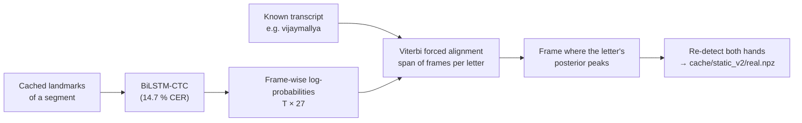

# Aligned real frames: a trustworthy real-world test

## The problem with the old frames

The first version of this project extracted "static" letter frames from the continuous videos by **dividing each segment's time evenly across its letters** and keeping the frame with the highest hand-detection confidence. But letters are not signed for equal durations, so many frames carried the **wrong label**. The 10.8 % real-world accuracy that this produced measured label noise as much as model quality.

## CTC forced alignment

`src/extraction/align_real_frames.py` finds *when* each letter is actually signed:

1. Run the BiLSTM-CTC on the segment.
2. Keep the segment only if its greedy transcription is close to the truth (**CER ≤ 0.15**), so the alignment can be trusted: 1,158 of 1,308 segments pass.
3. **Viterbi forced alignment** of the known transcript gives a span of frames for every letter.
4. Take the frame with the highest posterior inside the span (accept only if **≥ 0.6**).
5. Save the frame as a JPEG and detect both hands.

The result is **11,941 correctly-timed letter frames** (instead of 722), each with its video id so that the split is by video:

| Split | Frames |
|---|---:|
| train videos | 10,286 |
| validation videos | 586 |
| test videos | 1,069 |

## Why it matters

- It is the benchmark for *real-world* static recognition (small hands, full-body shot, real co-articulation).
- It is also **training data** for the target domain: DH-GAT v2 is trained on the training-video frames and evaluated on the held-out test videos.
- The same alignment code (`src/pipeline/ctc.py: forced_align`) later powers the "one key frame per letter" feature for uploaded videos.
