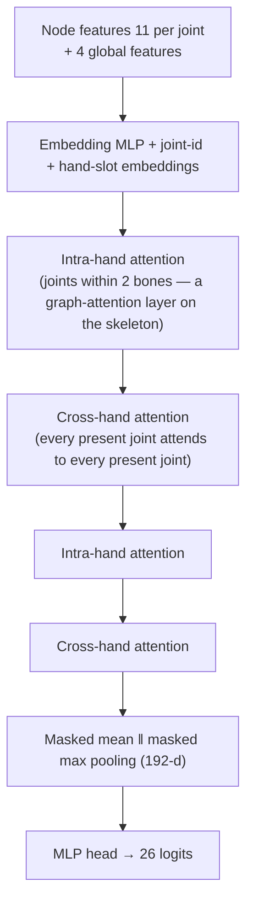

# DH-GAT — Dual-Hand Graph Attention

DH-GAT classifies a single frame into one of the 26 letters from the two hands' 21 joints each.

## Motivation

A baseline model that normalises each hand separately scored **98 %** on a random split but only **38 %** on letters from real videos. Two causes were identified:

1. **Information is discarded.** Normalising each hand separately means that *"right fingertip touching the left palm"* becomes indistinguishable from *"right fingertip far from the left hand"*.
2. **Domain gap.** The baseline was never trained on the target domain (frames from real videos), and the near-duplicate random split hid the problem.

## Graph

The two hands form a graph of **42 nodes** (2 × 21 joints) living in one **shared coordinate frame** (origin = mean of the two wrists, unit = mean hand size, the wrist → middle-finger-MCP distance). Layers alternate:

Absent hands are masked out of the attention (a node can always attend to itself), so the same network handles one-handed letters, two-handed letters and detector misses.

### Node features (11 per joint)

| Feature | Dim | Meaning |
|---|---:|---|
| `g` | 3 | position in the shared frame |
| `l` | 3 | position relative to its own wrist, scaled by its own hand size (as in the baseline) |
| `b` | 3 + 1 | unit vector and length of the bone to the parent joint |
| `m` | 1 | distance to the **nearest joint of the other hand** — a direct "contact" cue |

Global features (4): both-hands flag and the wrist-to-wrist vector in hand sizes.

### Size

2 intra + 2 cross blocks, `d = 96`, 4 heads, feed-forward `4d`, pre-norm, GELU — **502,970 parameters**.

### Hand slotting

Hands are ordered by wrist-x, **not** by MediaPipe's handedness label (which flips when a webcam preview is mirrored). A lone hand is always slot 0. Training augments with horizontal mirroring so the model is robust to left-handed signers and mirrored footage.

## Source

`src/models/dh_gat_v2.py` (`featurize()`, `DHGATv2`), `src/pipeline/classifier.py` (inference wrapper).
