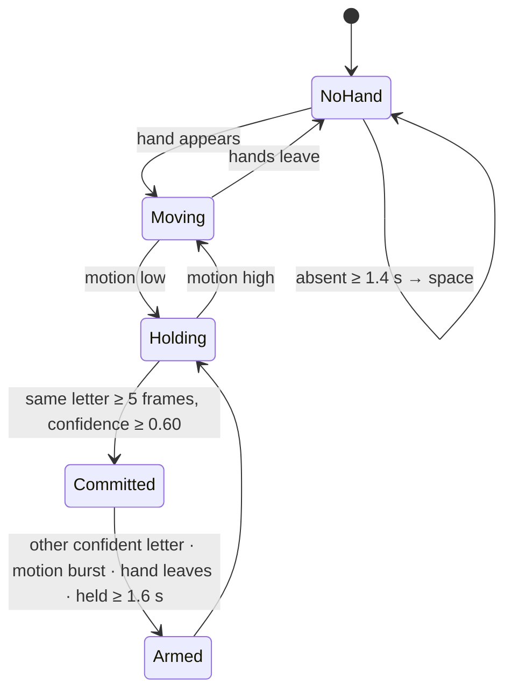

# From per-frame guesses to typed letters

The classifier produces a guess for **every** frame, including the frames in which the hands are travelling between letters. `src/pipeline/hold.py` decides *when* a letter has really been signed.

## State machine



Per frame:

1. **Motion** = mean displacement of all landmarks relative to the previous frame, in *hand sizes per frame*, smoothed (EMA 0.5). *Still* means `< 0.060`.
2. **Probabilities** are smoothed with an EMA (0.55 weight on the newest frame).
3. A letter is **committed** when its smoothed arg-max has been the same for **5 frames** (≈ 0.17 s), its confidence is **≥ 0.60** and the hand is still.
4. After a commit the recogniser must be **re-armed** before it can type again: a **different letter with confidence ≥ 0.5** is predicted for 4 frames (low-confidence flicker is ignored — second-hand recovery can briefly add a spurious hand to one-handed letters), a motion burst (> 0.10) occurs, the hand leaves, or the same sign is **held for 1.6 s** (auto-repeat, like a held key).
5. Hands absent for **1.4 s** → a **space**.

All thresholds are fields of `HoldConfig`.

## Key frames in uploaded videos

During a hold the frame with the **highest confidence** is remembered; when the letter commits, that frame becomes the letter's **key frame** (thumbnail and timestamp in the *Upload video* tab).

## What the HUD shows

| Element | Meaning |
|---|---|
| Large letter + coloured bar | current best guess and its calibrated confidence (red < 50 %, amber < 80 %, green) |
| Status label | `NO HAND` · `MOVING` · `HOLDING` · `LOCKED` (just typed) |
| Three chips | top-3 alternatives with percentages |
| Bottom banner | the text typed so far, with a blinking cursor |

## Test

`tests/test_static_pipeline.py` builds synthetic videos in which each letter of a word is a still image held for 0.8 s, with and without empty frames between letters:

```text
OK  word=HELLO    gaps=True  -> HELLO
OK  word=HELLO    gaps=False -> HELO     (expected HELO: an instant cut LL→L is ambiguous)
OK  word=INDIA    gaps=True  -> INDIA
OK  word=INDIA    gaps=False -> INDIA
OK  word=ABCDE    gaps=True  -> ABCDE
OK  word=ABCDE    gaps=False -> ABCDE
```

:::note Known limitation
A repeated letter with **no pause or motion at all** between the two signs is indistinguishable from a single long hold, unless the hold exceeds 1.6 s. Real signers lower or re-form the hands between repeats, which the detector sees as a motion burst.
:::
